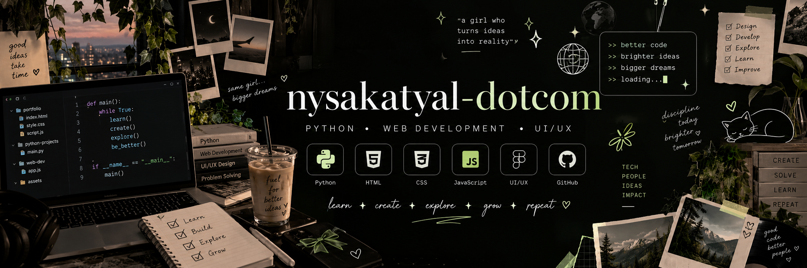

# Hey there, I'm Nysa! 👋

### 💻 BCA Student | Aspiring Software Developer | Creative Problem Solver

Welcome to my GitHub profile! ✨

I'm a Bachelor of Computer Applications (BCA) student passionate about technology, programming, and creativity. I enjoy learning new technologies, experimenting with code, and turning ideas into practical projects.

- 🎓 Currently pursuing a Bachelor of Computer Applications (BCA)
- 💻 Exploring Python programming and web development
- 🌱 Continuously learning new technologies and improving my coding skills
- 🎨 Creative at heart — I enjoy painting and exploring new skills
- 🚀 Goal: Become a skilled software developer and build meaningful digital experiences

---

## 🛠️ Tech Stack

### 💻 Programming Languages

### 🌐 Web Technologies

### 🔧 Tools & Platforms

---

## 🐍 Python Projects

I'm exploring Python through practical exercises and small projects that help me strengthen my programming fundamentals, improve logical thinking, and gain hands-on experience.

### 🖼️ 1. Python GIF Creator

A Python project focused on creating animated GIFs by combining images. It explores the use of Python libraries for image processing and animation.

- **Technologies:** Python, ImageIO
- **Key Concepts:**
  - Image processing
  - Working with external libraries
  - Handling image files
  - Creating animated GIFs
- **Learning Outcome:** Practised using Python libraries to process images and generate animated output.

🔗 [Explore My Repositories](https://github.com/nysakatyal-dotcom?tab=repositories)

### 🧩 2. Python Programming Practice

A collection of Python programming exercises designed to build a strong foundation in programming and problem-solving.

- **Technology:** Python
- **Key Concepts:**
  - Functions and return values
  - Lists and dictionaries
  - String manipulation
  - Sorting and iteration
  - Loops and conditional statements
  - Basic programming logic
- **Learning Outcome:** Improved understanding of Python syntax, functions, data structures, and reusable code.

🔗 [Explore My Repositories](https://github.com/nysakatyal-dotcom?tab=repositories)

### 🎯 What I'm Learning with Python

- Writing reusable functions
- Working with lists, strings, and dictionaries
- Processing and organising data
- Using libraries to extend program functionality
- Debugging code and solving programming problems

---

## 🌐 Web Development Projects

I'm learning how to build interactive, user-friendly websites using HTML, CSS, and JavaScript. These projects help me practise front-end development and apply my knowledge to practical applications.

### 🌟 1. Personal Portfolio Website

A personal portfolio website designed to introduce myself, showcase my skills, and present my web development journey in one place.

- **Technologies:** HTML5, CSS3, JavaScript
- **Features:**
  - Personal introduction
  - Skills and interests
  - Projects showcase
  - Website navigation
  - Responsive design
- **Learning Outcome:** Practised structuring web pages, styling layouts, and presenting information through a personal website.

🔗 [View Portfolio](https://nysakatyal-dotcom.github.io/web-development-projects/)

### 🧮 2. Interactive Calculator

An interactive calculator developed to practise JavaScript and implement basic mathematical operations through a simple user interface.

- **Technologies:** HTML5, CSS3, JavaScript
- **Features:**
  - Addition, subtraction, multiplication, and division
  - Interactive buttons
  - Calculation display
  - User-friendly interface
- **Learning Outcome:** Practised JavaScript logic, event handling, and interactive web page functionality.

🔗 [Try the Calculator](https://nysakatyal-dotcom.github.io/web-development-projects/calculator/)

### ⚡ 3. UNPLUGGED 2026 — Event Website

A fictional event-registration website designed with a modern black and neon-green theme. It presents an event concept through a visually engaging layout and an interactive registration interface.

- **Technologies:** HTML5, CSS3, JavaScript
- **Features:**
  - Modern black and neon-green design
  - Event introduction and details
  - Three featured events:
    - Ideas Unfiltered
    - Code After Dark
    - Creative Frequency
  - Sample event schedule
  - Registration form with browser-side validation
  - Interactive success message
  - Responsive layout
- **Learning Outcome:** Practised page styling, website structure, JavaScript form validation, and interactive user interface design.
- **Note:** The registration form is a demonstration only. Submitted information is not stored or transmitted to a server.

🔗 [Visit UNPLUGGED 2026](https://nysakatyal-dotcom.github.io/web-development-projects/event-registration/)

### 📁 Explore All Web Development Projects

🔗 [Web Development Projects Repository](https://github.com/nysakatyal-dotcom/web-development-projects)

---

## 📊 GitHub Statistics

---

## 🎯 Learning Goals

I'm continuously working to improve my programming and development skills.

- Strengthen my Python programming fundamentals
- Improve my understanding of JavaScript
- Build responsive and interactive websites
- Explore data structures and algorithms
- Improve problem-solving and debugging skills
- Learn more about front-end frameworks and libraries
- Explore back-end development and database integration
- Build projects that solve practical problems

---

## 🌱 What I'm Working On

- Practising Python through programming exercises and projects
- Developing interactive web applications
- Improving my understanding of HTML, CSS, and JavaScript
- Exploring new tools and technologies
- Expanding my project portfolio
- Learning through experimentation and hands-on practice

---

## 🎨 Beyond Coding

Creativity is an important part of who I am.

When I'm not coding, I enjoy:

- 🎨 Painting
- 🎵 Listening to music
- 🧁 Baking
- ✨ Exploring new skills

I enjoy combining creativity with technology to explore new ideas and create meaningful digital experiences.

---

## 🤝 Let's Connect

💻 **GitHub:** [@nysakatyal-dotcom](https://github.com/nysakatyal-dotcom)

📂 **Projects:** [Explore My Repositories](https://github.com/nysakatyal-dotcom?tab=repositories)

🌐 **Portfolio:** [Visit My Website](https://nysakatyal-dotcom.github.io/web-development-projects/)

---

⭐ Thanks for visiting my profile!

*Learning, building, creating, and improving — one project at a time.* ✨
